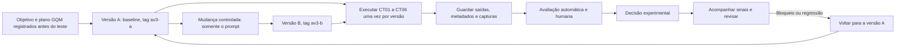

# Ciclo de vida e versionamento

Cadeia de mudança, execução, avaliação, decisão e acompanhamento do fluxo, com rastreabilidade entre casos, saídas e versões.

## Diagrama



## Cadeia de rastreabilidade

```text
caso (CT01 a CT06) -> saída (versão e caso) -> nota (R1, e R2 em quatro) -> decisão -> versão (A ou B)
```

Cada saída tem o nome `A-CT01` a `B-CT06` em `execucao/saidas-brutas/`, e as notas ligam o ID anônimo ao caso e à versão pela chave de anonimização.

## Versionamento das versões A e B

As duas versões foram salvas em commits antes de qualquer execução:

1. Commit da versão A, com o prompt e o manifesto de A, marcado com a tag `av3-a`.
2. Commit da versão B, com o prompt e o manifesto de B, marcado com a tag `av3-b`. A única mudança em relação a A é o prompt.

Para conferir: `git show av3-a` e `git show av3-b`. Nenhuma tag é movida ou reutilizada depois das execuções.

| Tag | Hash do commit |
| :--- | :--- |
| `av3-a` | `94528fe7c9cf5c2789a5b7d6191e60e9568a2a26` |
| `av3-b` | `1b5873d6d95a043efb70dedc06ac74f4bfe31f4e` |

## Reprodução e reversão

### É possível reconstruir uma saída pelo manifesto?

[PREENCHER: escolher uma saída, descrever os passos (checkout da tag, prompt, base de conhecimento, modelo) e dizer o que não pôde ser congelado, como o alias `latest` do modelo e a variação entre execuções.]

### Que sinal acompanhar depois e como voltar a A?

Acompanhar, por versão, a aprovação humana (aprovadas/6) e as falhas críticas. Qualquer falha crítica em B bloqueia a consideração de B até revisão. Para voltar a A: desativar B, restaurar o prompt de `versoes/A/prompt.md` (tag `av3-a`), manter o mesmo aplicativo, modelo e base, e registrar a data, o motivo e uma verificação com os casos.

## Abertura do vídeo

[PREENCHER: roteiro da abertura (30 a 60 segundos), apresentando a equipe e o objetivo.]
