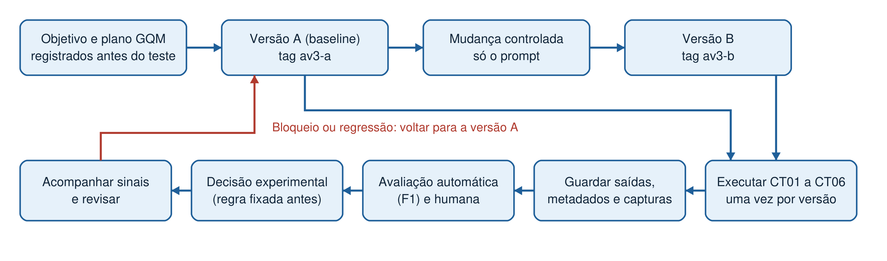
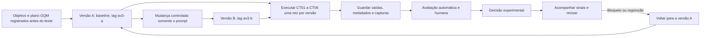

# Ciclo de vida e versionamento

Cadeia de mudança, execução, avaliação, decisão e acompanhamento do fluxo, com rastreabilidade entre casos, saídas e versões.

## Diagrama



O mesmo fluxo em Mermaid, que o GitHub desenha na própria página:



## Cadeia de rastreabilidade

```text
caso (CT01 a CT06) -> saída (versão e caso) -> nota (R1, e R2 em quatro) -> decisão -> versão (A ou B)
```

Cada saída tem o nome `A-CT01` a `B-CT06` em `execucao/saidas-brutas/`, e as notas ligam o ID anônimo ao caso e à versão pela chave de anonimização.

## Versionamento das versões A e B

As duas versões foram salvas em commits antes de qualquer execução:

1. Commit da versão A, com o prompt e o manifesto de A, marcado com a tag `av3-a`.
2. Commit da versão B, com o prompt e o manifesto de B, marcado com a tag `av3-b`. A única mudança em relação a A é o prompt.

Para conferir: `git show av3-a` e `git show av3-b`. Nenhuma tag é movida ou reutilizada depois das execuções.

| Tag | Hash do commit |
| :--- | :--- |
| `av3-a` | `94528fe7c9cf5c2789a5b7d6191e60e9568a2a26` |
| `av3-b` | `1b5873d6d95a043efb70dedc06ac74f4bfe31f4e` |

## Reprodução e reversão

### É possível reconstruir uma saída pelo manifesto?

Exemplo com a saída `B-CT05` (pergunta sem evidência suficiente). Passos para reconstruir:

1. `git checkout av3-b` para obter o prompt de [`../versoes/B/prompt.md`](../versoes/B/prompt.md) e o manifesto de B, e pegar a pergunta do CT05 em [`../casos.csv`](../casos.csv).
2. Instalar o Cherry Studio 2.0.13 e configurar o provedor Gemini com o modelo Gemini Flash-Lite Latest e os parâmetros padrão, sem prompt de sistema.
3. Criar a base com `DOC-01`, `DOC-03` e `DOC-04` de [`../../base-de-conhecimento/`](../../base-de-conhecimento/), com o embedding `gemini-embedding-001`, e vinculá-la ao assistente.
4. Abrir um tópico novo, enviar o texto do prompt B com a pergunta do CT05 no lugar de `[pergunta do caso]` e comparar com [`../execucao/saidas-brutas/B-CT05.md`](../execucao/saidas-brutas/B-CT05.md).

O que não pôde ser congelado:

- **Modelo:** o alias `latest` aponta para a revisão vigente do Gemini Flash-Lite, que o provedor pode trocar sem aviso.
- **Uso da base:** o modelo decide se consulta a base. Em `B-CT05` ele não consultou (sem "Processed" e sem citação) e mesmo assim se absteve corretamente. Em outra execução ele pode consultar e responder de outro jeito.
- **Variação entre execuções:** houve uma execução por caso e versão, e a mesma configuração pode gerar textos diferentes.
- **Índice da base:** recriar a base gera um novo índice, e os trechos recuperados podem mudar.

Por isso o manifesto permite reconstruir as **condições** da saída, mas não garante o mesmo texto. A saída original fica preservada em `execucao/saidas-brutas/` e nas capturas.

### Que sinal acompanhar depois e como voltar a A?

Acompanhar, por versão, a aprovação humana (aprovadas/6) e as falhas críticas. Qualquer falha crítica em B bloqueia a consideração de B até revisão. Para voltar a A: desativar B, restaurar o prompt de `versoes/A/prompt.md` (tag `av3-a`), manter o mesmo aplicativo, modelo e base, e registrar a data, o motivo e uma verificação com os casos.

## Abertura do vídeo

Rascunho para a equipe ajustar (cerca de 45 segundos):

> Olá, somos a Equipe 04 de Qualidade de Software, formada por Adam, Enzo, Douglas, Rafael, Raphael, Vinícius e Thayla. Na Atividade 3 testamos o fluxo de Base de Conhecimento do Cherry Studio com seis perguntas sobre a política de reembolso e a garantia da Cereja Eletro, uma empresa fictícia. Comparamos duas versões. Na versão A enviamos só a pergunta. Na versão B enviamos um prompt estruturado, com regras de uso de fonte e de abstenção. Medimos cada resposta de dois jeitos, com um sinal automático, o F1 lexical, e com a avaliação de duas pessoas. A pergunta que guiou o trabalho foi se essa mudança simples melhora as respostas e até que ponto a métrica automática concorda com o julgamento humano. A seguir mostramos o plano, a execução, os resultados e a decisão.
