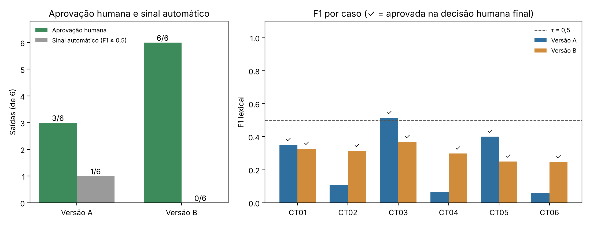

# Resultados

Consolidação dos resultados das 12 saídas. Os arquivos abaixo são gerados depois das execuções e das avaliações.

| Arquivo | Conteúdo |
| :--- | :--- |
| `f1-lexical.csv` | P, R, F1 e sinal automático das 12 saídas (ver [`../metricas/`](../metricas/)) |
| `tabela-consolidada.csv` | Para cada saída: caso e versão, F1, sinal automático, notas humanas, decisão humana final e justificativa |
| `grafico-resultados.png` | Gráfico comparativo de A e B |
| `divergencia.md` | Análise de uma divergência entre o sinal automático e a decisão humana, ou de um caso-limite |

## Resumo por versão

| Versão | F1 médio | F1 mediano | Sinais automáticos positivos | Aprovação humana | Falhas críticas |
| :--- | ---: | ---: | ---: | ---: | ---: |
| A | 0,249 | 0,229 | 1/6 | 3/6 | 1 (CT02) |
| B | 0,300 | 0,306 | 0/6 | 6/6 | 0 |

A tabela completa está em [`tabela-consolidada.csv`](tabela-consolidada.csv), o resumo gerado pelo script em [`resumo-automatico.md`](resumo-automatico.md) e o gráfico em [`grafico-resultados.png`](grafico-resultados.png).

## Concordância entre o sinal automático e a decisão humana

**4/12.** O sinal coincidiu com a decisão humana em CT02-A, CT03-A, CT04-A e CT06-A. Nas outras oito saídas o F1 ficou abaixo de 0,5 e a decisão humana foi aprovar. Não houve nenhum caso de sinal positivo com reprovação humana.

## Respostas às questões

- **Questão 1, B melhorou a qualidade humana ou apenas a métrica?** B melhorou a qualidade humana. A aprovação subiu de 3/6 para 6/6 e a falha crítica de A desapareceu. O F1 quase não mudou (de 0,249 para 0,300 na média) e o número de sinais positivos até caiu (de 1/6 para 0/6). As três saídas reprovadas em A (CT02, CT04 e CT06) foram as que responderam sem consultar a base, com regras gerais do CDC. Em B, todas as respostas que consultaram a base citaram a fonte. Com seis casos e uma execução por caso, o resultado indica uma melhora, mas não a demonstra de forma geral.
- **Questão 2, qual saída mostra o limite do F1 e qual a evidência?** A B-CT05. Ela responde "Não encontrei essa informação nos documentos.", que é a abstenção esperada, aprovada por R1 e R2, e mesmo assim tem F1 de 0,250, porque usa palavras diferentes das da referência. A análise está em [`divergencia.md`](divergencia.md).
